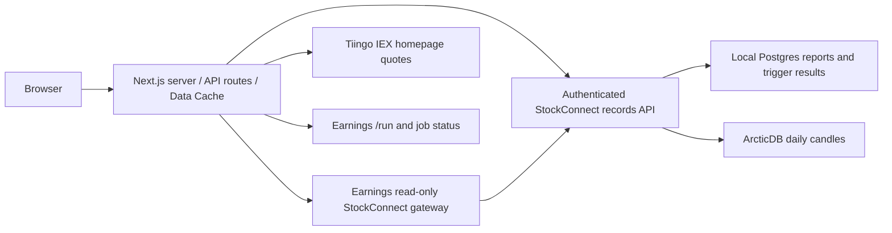

# Stockview

Research reports are read from StockConnect's local PostgreSQL database through its authenticated records API. Supabase is no longer a dependency.

## Architecture and deployment

See [StockConnect’s system architecture](https://github.com/family-stocks/stockconnect/blob/main/docs/ARCHITECTURE.md) for the backend services, trigger schedules and data stores.

The server uses either a direct records connection or the gateway, not both for every request. The deployed container engine is OrbStack. The UI can also run on Vercel. A hosted UI still depends on the Mac, SSD, records service and tunnel for uncached backend reads. Stockview does not schedule triggers or perform full earnings research.

## Local container setup

Start StockConnect's records stack first. Create a private .env.local with STOCKCONNECT_RECORDS_URL=http://stockconnect-records-records-api-1:8000 and STOCKCONNECT_RECORDS_API_KEY matching StockConnect. Then run:

    docker --context orbstack compose -p stockview up -d --build

Open http://localhost:3000. The app is bound to localhost. For native Next.js development use http://127.0.0.1:8081 as the records URL instead.

The records key is server-only: never use a NEXT_PUBLIC_ variable for it. The browser calls the read-only /api/reports route; it cannot use that route to insert records. List queries paginate and request only summary columns; detail pages fetch the full report. Successful report snapshots use 60-second revalidation; a refresh can briefly show the previous snapshot while the server refreshes it.

Chart history and technical indicators read daily OHLCV from StockConnect on the external SSD. Chart requests never call Tiingo or fall back to a provider when local history is missing. The homepage live-price route still calls Tiingo IEX with its existing 60-second cache and requires TIINGO_API_KEY (configured in the local deployment). RESEARCH_API_URL and RESEARCH_API_KEY remain optional for submitting and tracking new research jobs. The research-job integration is separate from report storage and is not configured by the database migration. Jobs currently remain in browser-local tracking and the earnings API. The configured earnings gateway supports read-only records access for hosted clients.

Validation: production build and live records list/detail checks. Repository-wide lint has pre-existing errors in JobsClient.tsx and UploadModal.tsx.

## Hosted Vercel deployment

The GitHub master branch deploys to the existing Vercel production project.
When STOCKCONNECT_RECORDS_URL is absent, the server derives its connection from
RESEARCH_API_URL (removing /run and appending /stockconnect) and authenticates with
RESEARCH_API_KEY. The earnings API gateway only exposes GET reports, candles and trigger results;
it does not expose database writes. Existing research-job routes and live Tiingo
quotes keep their current configuration. All credentials stay server-side.

The Mac, external SSD, records API and Tailscale Funnel must stay available for
uncached hosted reports and charts. There is no Supabase fallback. API errors are shown as unavailable.

## Trigger results

The Triggers tab (`/triggers`) reads StockConnect's persisted research decisions.
Filter by ticker, report-price/news/earnings-calendar/daily-discovery trigger, and
submission outcome. Expand a result for rationale, risks, source links, evidence
and the submitted job ID. Sent means accepted by the agent, not completed.
Results paginate 25 at a time, newest first; timestamps are UTC. Refresh requests the current server snapshot, subject to the cache policy below. Scan-level exclusions remain in StockConnect's scan audit database.
The hosted earnings gateway must allow GET `/stockconnect/v1/trigger-results` with
`limit`, `offset`, `ticker`, `trigger_type` and `outcome` parameters. Credentials
remain on the server.

### StockConnect read caching

On Vercel, the protected reports refresh endpoint writes a shared report summary
snapshot. The dashboard marks that snapshot as stale after 20 minutes. Without a
scheduled snapshot, report summaries use the Next.js Data Cache with a 60-second
refresh interval. Full ticker reports try the upstream first and can fall back
to a cached result. Trigger results use a 60-second interval and daily candles
use 15 minutes. Cached results remain available if an upstream refresh fails. Reports
cache the complete pagination result together, compressed to fit the cache item
size limit. Cache keys isolate the backend, credentials, ticker and query.
Dashboard and trigger pages show the snapshot fetch time. Existing dashboard
rows stay visible if a later request fails. Live Tiingo prices and job/submission
endpoints are unchanged and are not part of this cache.

A cold or evicted cache still requires a healthy upstream. Cached results can be
older during an outage; a first request after the refresh interval can return
the old snapshot while the refresh runs. This improves availability but does
not repair StockConnect database crashes.
